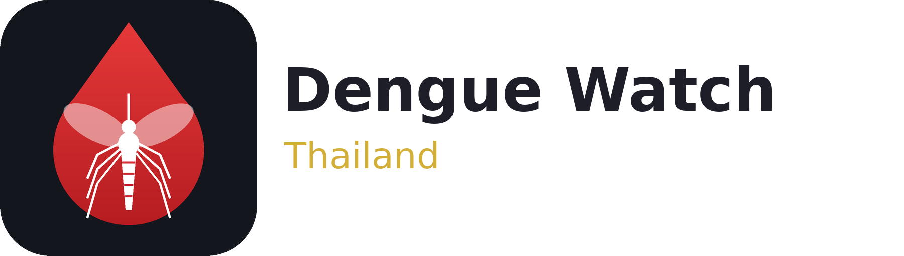

<p align="center">
  
</p>

<p align="center">
  <b>Is dengue unusually high in your province right now?</b><br>
  Weekly dengue cases from Thailand's national disease surveillance, compared with the five years before - in Home Assistant.
</p>

<p align="center">
  <a href="https://github.com/hacs/integration"></a>
  <a href="https://github.com/mb26-dev/ha-dengue-watch/releases"></a>
  
  <a href="LICENSE"></a>
  <a href="https://ko-fi.com/mb26dev"></a>
</p>

---

Mosquito apps and weather cards can tell you when conditions favour *Aedes* mosquitoes. They cannot tell you whether the virus is actually going around. Thailand's Department of Disease Control (DDC) collects every reported dengue case in its **Digital Disease Surveillance** (Report 506) and publishes the numbers per province on its public dashboard. This integration reads them once every few hours and answers one question: **are there more cases than usual for this time of year?**

> [!NOTE]
> Unofficial integration, not affiliated with or endorsed by the Department of Disease Control. It reads the CSV export of the public DDS dashboard. If the DDC changes the dashboard, the integration may need an update. The numbers are reported cases and can be revised for several weeks; they are not medical advice.

## ✨ Features

- **Level sensor** for your province: *below normal*, *normal*, *elevated* or *high* - the cases of the last 4 complete weeks against the 5-year median of the same weeks.
- **Cases in the last 4 weeks** and **cases this year**.
- Attributes for charts and cards: weekly cases and 5-year median of the last 12 weeks, trend, ratio, same period last year.
- All 77 provinces; the setup suggests the one of your Home Assistant location.
- English, Thai and German translations.

Pairs with the [Tropical Weather Card](https://github.com/mb26-dev/ha-tropical-weather): set `dengue: sensor.dengue_<province>_level` and its mosquito tile shows the dengue situation next to the weather-based mosquito activity.

## 📦 Installation

### HACS (recommended)

[](https://my.home-assistant.io/redirect/hacs_repository/?owner=mb26-dev&repository=ha-dengue-watch&category=integration)

1. Open **HACS** in Home Assistant, search for **Dengue Watch Thailand** and install it.
2. Restart Home Assistant.
3. **Settings → Devices & services → Add integration → Dengue Watch Thailand**, then pick your province.

<details>
<summary>Not showing up in HACS yet? Add it as a custom repository</summary>

1. HACS → ⋮ → **Custom repositories** → add `https://github.com/mb26-dev/ha-dengue-watch`, type **Integration**.
2. Install **Dengue Watch Thailand** and restart Home Assistant.

</details>

### Manual

Copy `custom_components/dengue_watch` into your `config/custom_components/` folder and restart Home Assistant.

## ⚙️ Entities

For the province *Krabi*:

| Entity | Content |
|---|---|
| `sensor.dengue_krabi_level` | `low`, `normal`, `elevated` or `high` |
| `sensor.dengue_krabi_cases_last_4_weeks` | Reported cases in the last 4 complete weeks |
| `sensor.dengue_krabi_cases_this_year` | Reported cases since 1 January |

Attributes of the level sensor:

| Attribute | Meaning |
|---|---|
| `cases_last_4_weeks`, `expected_last_4_weeks` | Cases and the sum of the 5-year weekly medians over the same 4 weeks |
| `ratio` | Cases divided by expected |
| `trend` | `rising`, `falling` or `steady` (last 2 weeks against the 2 before) |
| `cases_this_year`, `cases_same_period_last_year` | Year to date, and the same weeks one year earlier |
| `latest_week`, `latest_week_start` | Newest complete week, e.g. `2026-W47` |
| `weeks`, `weekly_cases`, `weekly_median` | The last 12 weeks for charts |
| `baseline_years` | Years used for the median |

### Example: notification when dengue rises

```yaml
triggers:
  - trigger: state
    entity_id: sensor.dengue_krabi_level
    to: [elevated, high]
actions:
  - action: notify.notify
    data:
      title: Dengue in Krabi
      message: >-
        {{ state_attr('sensor.dengue_krabi_level', 'cases_last_4_weeks') }} cases in 4 weeks,
        usually {{ state_attr('sensor.dengue_krabi_level', 'expected_last_4_weeks') }}.
        Empty standing water and use repellent.
```

## 🔬 How it works

- **Source:** the DDS dashboard *Disease situation* (รายงานสถานการณ์โรค) of the DDC Division of Epidemiology, filtered to the three dengue diagnoses of Report 506 (dengue fever, dengue haemorrhagic fever, dengue shock syndrome) and your province. The dashboard is refreshed about every 6 hours; the integration polls every 6 hours.
- **Weeks** run Sunday to Saturday and restart on 1 January, as on the dashboard. The running week is not complete and is left out; if the newest week has no data yet, the integration steps back.
- **Baseline:** for every week the median of the same week in the five years before.
- **Level:** *high* - more than twice the median and at least 10 cases; *elevated* - more than the median plus 2 cases; *below normal* - less than half the median (when at least 4 are expected); otherwise *normal*. The margins keep single cases from switching the level in small provinces.

## 🧪 Development

```bash
python tests/test_surveillance.py   # parser, epidemiological weeks, levels (no Home Assistant needed)
```

## 📄 License

MIT - see [LICENSE](LICENSE). Surveillance data © Department of Disease Control, Ministry of Public Health Thailand.
