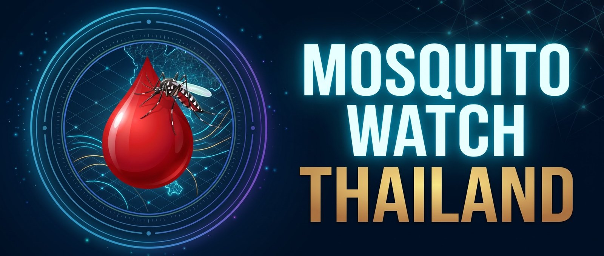
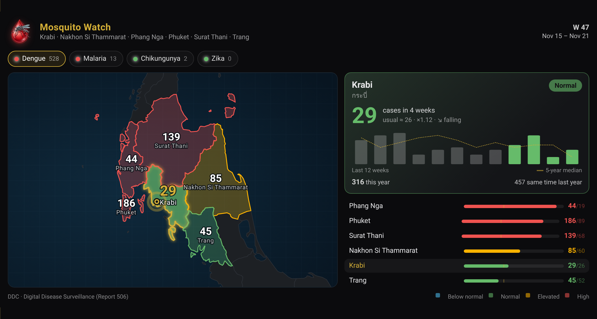

<p align="center">
  
</p>

<p align="center">
  <b>Are mosquito-borne diseases unusually high around you right now?</b><br>
  Weekly cases of dengue, malaria, chikungunya and Zika from Thailand's national disease surveillance, per province, against the five years before - with a map card for Home Assistant.
</p>

<p align="center">
  <a href="https://github.com/hacs/integration"></a>
  <a href="https://github.com/mb26-dev/ha-dengue-watch/releases"></a>
  
  <a href="LICENSE"></a>
  <a href="https://ko-fi.com/mb26dev"></a>
</p>

<p align="center"></p>

---

Mosquito apps and weather cards can tell you when conditions favour mosquitoes. They cannot tell you whether a virus is actually going around. Thailand's Department of Disease Control (DDC) collects every reported case in its **Digital Disease Surveillance** (Report 506) and publishes the numbers per province on its public dashboard. This integration reads them for the provinces you pick and answers one question per disease: **are there more cases than usual for this time of year?**

*Formerly "Dengue Watch Thailand" - same repository, same integration; existing installations are migrated.*

> [!NOTE]
> Unofficial integration, not affiliated with or endorsed by the Department of Disease Control. It reads the CSV export of the public DDS dashboard. If the DDC changes the dashboard, the integration may need an update. The numbers are reported cases and can be revised for several weeks; they are not medical advice.

## ✨ Features

- **Four mosquito-borne diseases:** dengue (dengue fever, DHF and DSS together), malaria, chikungunya and Zika.
- **Any set of provinces**, picked in the UI. Setup preselects your province and its neighbours (within about 110 km of the Home Assistant location); change them any time under *Configure*.
- **Level per province and disease:** *below normal*, *normal*, *elevated* or *high* - the last 4 complete weeks against the 5-year median of the same weeks.
- **Mosquito Watch card** included - no extra install, no YAML: a map of your provinces coloured by level, disease tabs, a detail panel with the last 12 weeks against the median, and a ranking. Click a province for its details.
- Gentle on the DDC server: one export after another with a pause, refreshed every 6 hours, cached on disk so a restart shows the last values at once.
- English, Thai and German.

Pairs with the [Tropical Weather Card](https://github.com/mb26-dev/ha-tropical-weather): set `dengue: sensor.dengue_<province>_level` and its mosquito tile shows the dengue situation next to the weather-based mosquito activity.

## 📦 Installation

### HACS (recommended)

[](https://my.home-assistant.io/redirect/hacs_repository/?owner=mb26-dev&repository=ha-dengue-watch&category=integration)

1. Open **HACS** in Home Assistant, search for **Mosquito Watch Thailand** and install it.
2. Restart Home Assistant.
3. **Settings → Devices & services → Add integration → Mosquito Watch Thailand**, check the provinces and diseases.

<details>
<summary>Not showing up in HACS yet? Add it as a custom repository</summary>

1. HACS → ⋮ → **Custom repositories** → add `https://github.com/mb26-dev/ha-dengue-watch`, type **Integration**.
2. Install **Mosquito Watch Thailand** and restart Home Assistant.

</details>

### Manual

Copy `custom_components/dengue_watch` into your `config/custom_components/` folder and restart Home Assistant.

## 🗺️ The card

After installing, open a dashboard → **Add card** → **Mosquito Watch**. It finds the sensors of the integration by itself. Optional settings in the card editor: title, the disease shown first, map height.

```yaml
type: custom:mosquito-watch-card
disease: dengue   # optional
```

The first full download after setup takes a few minutes (about 10 s per province and disease); the card fills in as the data arrives.

## ⚙️ Entities

One device per province (*Mosquito Watch Krabi*), and per disease:

| Entity | Content |
|---|---|
| `sensor.<disease>_<province>_level` | `low`, `normal`, `elevated` or `high`, e.g. `sensor.dengue_krabi_level`, `sensor.malaria_phuket_level` |
| `sensor.<disease>_<province>_cases_last_4_weeks` | Reported cases in the last 4 complete weeks |
| `sensor.<disease>_<province>_cases_this_year` | Reported cases since 1 January (disabled by default) |

Attributes of the level sensors:

| Attribute | Meaning |
|---|---|
| `cases_last_4_weeks`, `expected_last_4_weeks` | Cases and the sum of the 5-year weekly medians over the same 4 weeks |
| `ratio` | Cases divided by expected |
| `trend` | `rising`, `falling` or `steady` (last 2 weeks against the 2 before) |
| `cases_this_year`, `cases_same_period_last_year` | Year to date, and the same weeks one year earlier |
| `latest_week`, `latest_week_start` | Newest complete week, e.g. `2026-W47` |
| `weeks`, `weekly_cases`, `weekly_median` | The last 12 weeks for charts |
| `province`, `province_th`, `disease` | What the sensor is about |

### Example: notification when dengue rises

```yaml
triggers:
  - trigger: state
    entity_id: sensor.dengue_krabi_level
    to: [elevated, high]
actions:
  - action: notify.notify
    data:
      title: Dengue in Krabi
      message: >-
        {{ state_attr('sensor.dengue_krabi_level', 'cases_last_4_weeks') }} cases in 4 weeks,
        usually {{ state_attr('sensor.dengue_krabi_level', 'expected_last_4_weeks') }}.
        Empty standing water and use repellent.
```

## 🔬 How it works

- **Source:** the DDS dashboard *Disease situation* (รายงานสถานการณ์โรค) of the DDC Division of Epidemiology, filtered to one disease of Report 506 and one province per export (dengue = dengue fever, dengue haemorrhagic fever and dengue shock syndrome). The dashboard is refreshed about every 6 hours; the integration fetches every pair every 6 hours, one after another with a short pause.
- **Weeks** run Sunday to Saturday and restart on 1 January, as on the dashboard. The running week is not complete and is left out; if the newest week has no data yet, the integration steps back.
- **Baseline:** for every week the median of the same week in the five years before.
- **Level:** *high* - more than twice the median and at least 10 cases; *elevated* - more than the median plus 2 cases; *below normal* - less than half the median (when at least 4 are expected); otherwise *normal*. The margins keep single cases from switching the level in small provinces.

## 🧪 Development

```bash
python tests/test_surveillance.py   # parser, epidemiological weeks, levels (no Home Assistant needed)
```

## 📄 License

MIT - see [LICENSE](LICENSE). Surveillance data © Department of Disease Control, Ministry of Public Health Thailand. Province outlines from [thailand.json](https://github.com/apisit/thailand.json) by Apisit Toompakdee (MIT), simplified.
